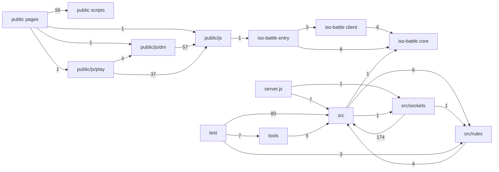
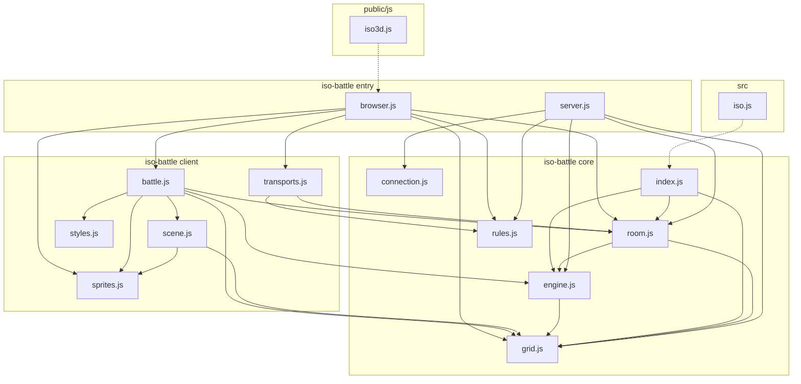
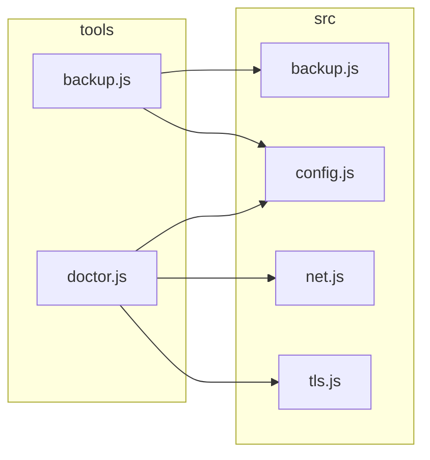

# Module graph

Generated by `tools/module-graph.js` from the real `require`, `import` and `<script src>` lines.
Do not edit by hand. Regenerate with `npm run graph` after adding or moving modules.

378 files scanned, 1010 internal edges. Arrows point from the file that imports to the file it imports.
Dotted arrows go through a committed build (`lib/iso-battle/dist/core.cjs` or `public/iso/iso-battle.js`)
and point at the source it is built from. Node built-ins are left out; npm packages are listed at the end.

## Overview

One box per area. The number on an arrow is how many file-to-file imports cross it.

## Server core

`server.js`, `src/` and `src/rules/`, without the socket handlers.

```mermaid
flowchart LR
  subgraph n_g_server_js["server.js"]
    n_server_js["server.js"]
  end
  subgraph n_g_src["src"]
    n_src_absent_js["absent.js"]
    n_src_assets_js["assets.js"]
    n_src_backup_js["backup.js"]
    n_src_bulbs_js["bulbs.js"]
    n_src_bundle_js["bundle.js"]
    n_src_camp_js["camp.js"]
    n_src_cast_js["cast.js"]
    n_src_clock_js["clock.js"]
    n_src_combatfx_js["combatfx.js"]
    n_src_config_js[["config.js<br/>(used by 20)"]]
    n_src_creatures_js["creatures.js"]
    n_src_designer_js["designer.js"]
    n_src_dice_js["dice.js"]
    n_src_downtime_js["downtime.js"]
    n_src_dungeon_js["dungeon.js"]
    n_src_entities_js["entities.js"]
    n_src_factions_js["factions.js"]
    n_src_features_js["features.js"]
    n_src_game_js["game.js"]
    n_src_grid_js["grid.js"]
    n_src_houserules_js["houserules.js"]
    n_src_hub_js[["hub.js<br/>(used by 10)"]]
    n_src_iso_js["iso.js"]
    n_src_itemlib_js["itemlib.js"]
    n_src_keywords_js["keywords.js"]
    n_src_layered_js["layered.js"]
    n_src_legacy_js["legacy.js"]
    n_src_legends_js["legends.js"]
    n_src_library_js["library.js"]
    n_src_living_js["living.js"]
    n_src_lobby_js["lobby.js"]
    n_src_lore_js["lore.js"]
    n_src_lorebook_js["lorebook.js"]
    n_src_mapview_js["mapview.js"]
    n_src_media_js["media.js"]
    n_src_messages_js["messages.js"]
    n_src_moments_js["moments.js"]
    n_src_net_js["net.js"]
    n_src_perception_js["perception.js"]
    n_src_placeholder_sounds_js["placeholder-sounds.js"]
    n_src_plan_js["plan.js"]
    n_src_popups_js["popups.js"]
    n_src_puzzle_js["puzzle.js"]
    n_src_quiz_js["quiz.js"]
    n_src_recorder_js["recorder.js"]
    n_src_renpy_js["renpy.js"]
    n_src_rests_js["rests.js"]
    n_src_roles_js["roles.js"]
    n_src_rolls_js["rolls.js"]
    n_src_roster_js[["roster.js<br/>(used by 11)"]]
    n_src_routes_js["routes.js"]
    n_src_safety_js["safety.js"]
    n_src_saves_js["saves.js"]
    n_src_session_js["session.js"]
    n_src_sheet_js["sheet.js"]
    n_src_shops_js["shops.js"]
    n_src_soundscape_js["soundscape.js"]
    n_src_speech_js["speech.js"]
    n_src_spells_js["spells.js"]
    n_src_srd_js["srd.js"]
    n_src_state_js[["state.js<br/>(used by 18)"]]
    n_src_store_js["store.js"]
    n_src_storybook_js["storybook.js"]
    n_src_storygraph_js["storygraph.js"]
    n_src_storypack_js["storypack.js"]
    n_src_table_state_js["table-state.js"]
    n_src_table_js["table.js"]
    n_src_templates_js["templates.js"]
    n_src_testparty_js["testparty.js"]
    n_src_timers_js["timers.js"]
    n_src_tls_js["tls.js"]
    n_src_town_js["town.js"]
    n_src_tracker_js["tracker.js"]
    n_src_trail_js["trail.js"]
    n_src_undo_js["undo.js"]
    n_src_util_js[["util.js<br/>(used by 47)"]]
    n_src_visibility_js["visibility.js"]
    n_src_vision_js["vision.js"]
    n_src_web_js["web.js"]
    n_src_wiki_js["wiki.js"]
    n_src_world_js["world.js"]
    n_src_worldmap_js["worldmap.js"]
  end
  subgraph n_g_src_rules["src/rules"]
    n_src_rules_daggerheart_js["daggerheart.js"]
    n_src_rules_dnd5e_js["dnd5e.js"]
    n_src_rules_index_js["index.js"]
  end
  n_server_js --> n_src_net_js
  n_server_js --> n_src_tls_js
  n_server_js --> n_src_routes_js
  n_server_js --> n_src_safety_js
  n_src_absent_js --> n_src_visibility_js
  n_src_bundle_js --> n_src_entities_js
  n_src_bundle_js --> n_src_rules_index_js
  n_src_bundle_js --> n_src_assets_js
  n_src_bundle_js --> n_src_creatures_js
  n_src_bundle_js --> n_src_spells_js
  n_src_bundle_js --> n_src_sheet_js
  n_src_bundle_js --> n_src_srd_js
  n_src_clock_js --> n_src_moments_js
  n_src_creatures_js --> n_src_library_js
  n_src_designer_js --> n_src_library_js
  n_src_entities_js --> n_src_store_js
  n_src_game_js --> n_src_media_js
  n_src_game_js --> n_src_absent_js
  n_src_game_js --> n_src_timers_js
  n_src_game_js --> n_src_iso_js
  n_src_game_js --> n_src_combatfx_js
  n_src_game_js --> n_src_grid_js
  n_src_game_js --> n_src_world_js
  n_src_grid_js --> n_src_iso_js
  n_src_itemlib_js --> n_src_library_js
  n_src_keywords_js --> n_src_library_js
  n_src_layered_js --> n_src_assets_js
  n_src_legacy_js --> n_src_session_js
  n_src_legends_js --> n_src_store_js
  n_src_library_js --> n_src_store_js
  n_src_living_js --> n_src_factions_js
  n_src_lore_js --> n_src_entities_js
  n_src_lore_js --> n_src_itemlib_js
  n_src_lorebook_js --> n_src_wiki_js
  n_src_lorebook_js --> n_src_lore_js
  n_src_lorebook_js --> n_src_designer_js
  n_src_media_js --> n_src_assets_js
  n_src_plan_js --> n_src_creatures_js
  n_src_plan_js --> n_src_rules_index_js
  n_src_popups_js --> n_src_camp_js
  n_src_renpy_js --> n_src_storybook_js
  n_src_renpy_js --> n_src_storypack_js
  n_src_rests_js --> n_src_dice_js
  n_src_rolls_js --> n_src_dice_js
  n_src_rolls_js --> n_src_legends_js
  n_src_rolls_js --> n_src_storybook_js
  n_src_rolls_js --> n_src_timers_js
  n_src_roster_js --> n_src_rules_index_js
  n_src_roster_js --> n_src_sheet_js
  n_src_roster_js --> n_src_store_js
  n_src_routes_js --> n_src_roles_js
  n_src_routes_js --> n_src_net_js
  n_src_routes_js --> n_src_media_js
  n_src_routes_js --> n_src_assets_js
  n_src_routes_js --> n_src_layered_js
  n_src_routes_js --> n_src_placeholder_sounds_js
  n_src_routes_js --> n_src_tls_js
  n_src_routes_js --> n_src_bundle_js
  n_src_routes_js --> n_src_backup_js
  n_src_routes_js --> n_src_storybook_js
  n_src_routes_js --> n_src_creatures_js
  n_src_routes_js --> n_src_spells_js
  n_src_routes_js --> n_src_srd_js
  n_src_routes_js --> n_src_designer_js
  n_src_routes_js --> n_src_keywords_js
  n_src_routes_js --> n_src_itemlib_js
  n_src_routes_js --> n_src_world_js
  n_src_rules_daggerheart_js --> n_src_dice_js
  n_src_rules_dnd5e_js --> n_src_dice_js
  n_src_rules_index_js --> n_src_rules_dnd5e_js
  n_src_rules_index_js --> n_src_rules_daggerheart_js
  n_src_saves_js --> n_src_store_js
  n_src_sheet_js --> n_src_rules_index_js
  n_src_sheet_js --> n_src_shops_js
  n_src_sheet_js --> n_src_rests_js
  n_src_soundscape_js --> n_src_placeholder_sounds_js
  n_src_spells_js --> n_src_library_js
  n_src_srd_js --> n_src_creatures_js
  n_src_srd_js --> n_src_spells_js
  n_src_state_js --> n_src_visibility_js
  n_src_state_js --> n_src_rules_index_js
  n_src_state_js --> n_src_media_js
  n_src_state_js --> n_src_net_js
  n_src_state_js --> n_src_session_js
  n_src_state_js --> n_src_store_js
  n_src_state_js --> n_src_saves_js
  n_src_state_js --> n_src_sheet_js
  n_src_state_js --> n_src_library_js
  n_src_state_js --> n_src_perception_js
  n_src_state_js --> n_src_plan_js
  n_src_state_js --> n_src_downtime_js
  n_src_state_js --> n_src_camp_js
  n_src_state_js --> n_src_cast_js
  n_src_state_js --> n_src_legends_js
  n_src_state_js --> n_src_houserules_js
  n_src_state_js --> n_src_absent_js
  n_src_state_js --> n_src_recorder_js
  n_src_state_js --> n_src_storybook_js
  n_src_state_js --> n_src_table_state_js
  n_src_state_js --> n_src_worldmap_js
  n_src_state_js --> n_src_living_js
  n_src_state_js --> n_src_web_js
  n_src_state_js --> n_src_dungeon_js
  n_src_state_js --> n_src_undo_js
  n_src_state_js --> n_src_placeholder_sounds_js
  n_src_state_js --> n_src_soundscape_js
  n_src_state_js --> n_src_moments_js
  n_src_state_js --> n_src_town_js
  n_src_state_js --> n_src_templates_js
  n_src_state_js --> n_src_srd_js
  n_src_state_js --> n_src_storygraph_js
  n_src_state_js --> n_src_entities_js
  n_src_state_js --> n_src_shops_js
  n_src_state_js --> n_src_trail_js
  n_src_state_js --> n_src_bulbs_js
  n_src_state_js --> n_src_lobby_js
  n_src_state_js --> n_src_features_js
  n_src_state_js --> n_src_rolls_js
  n_src_state_js --> n_src_safety_js
  n_src_store_js --> n_src_media_js
  n_src_store_js --> n_src_worldmap_js
  n_src_storybook_js --> n_src_moments_js
  n_src_storypack_js --> n_src_storybook_js
  n_src_storypack_js --> n_src_bundle_js
  n_src_table_js --> n_src_world_js
  n_src_table_js --> n_src_table_state_js
  n_src_table_js --> n_src_media_js
  n_src_testparty_js --> n_src_sheet_js
  n_src_timers_js --> n_src_tracker_js
  n_src_timers_js --> n_src_rolls_js
  n_src_tls_js --> n_src_net_js
  n_src_tracker_js --> n_src_sheet_js
  n_src_tracker_js --> n_src_rests_js
  n_src_visibility_js --> n_src_sheet_js
  n_src_visibility_js --> n_src_factions_js
  n_src_visibility_js --> n_src_living_js
  n_src_visibility_js --> n_src_shops_js
  n_src_visibility_js --> n_src_messages_js
  n_src_visibility_js --> n_src_mapview_js
  n_src_visibility_js --> n_src_vision_js
  n_src_visibility_js --> n_src_downtime_js
  n_src_visibility_js --> n_src_absent_js
  n_src_visibility_js --> n_src_camp_js
  n_src_visibility_js --> n_src_rests_js
  n_src_visibility_js --> n_src_table_js
  n_src_visibility_js --> n_src_worldmap_js
  n_src_visibility_js --> n_src_lore_js
  n_src_visibility_js --> n_src_speech_js
  n_src_visibility_js --> n_src_quiz_js
  n_src_visibility_js --> n_src_moments_js
  n_src_visibility_js --> n_src_puzzle_js
  n_src_visibility_js --> n_src_dungeon_js
  n_src_visibility_js --> n_src_town_js
  n_src_visibility_js --> n_src_web_js
  n_src_visibility_js --> n_src_perception_js
  n_src_visibility_js --> n_src_rules_index_js
  n_src_visibility_js --> n_src_net_js
  n_src_visibility_js --> n_src_saves_js
  n_src_visibility_js --> n_src_undo_js
  n_src_visibility_js --> n_src_features_js
  n_src_vision_js --> n_src_grid_js
  n_src_vision_js --> n_src_iso_js
  n_src_web_js --> n_src_factions_js
  n_src_world_js --> n_src_templates_js
  n_src_world_js --> n_src_soundscape_js
```

Drawn without arrows (imported by more than 8 modules here): `src/config.js`, `src/hub.js`, `src/roster.js`, `src/state.js`, `src/util.js`.

## Socket handlers

What each file in `src/sockets/` loads. A table, because 20-odd handlers that each load many modules make an unreadable chart.

| Handler | Loads |
| --- | --- |
| `src/sockets/atmo.js` | `src/hub.js`, `src/assets.js`, `src/state.js`, `src/media.js`, `src/soundscape.js`, `src/sockets/living.js`, `src/living.js` |
| `src/sockets/designer.js` | `src/state.js`, `src/designer.js`, `src/keywords.js`, `src/wiki.js`, `src/lore.js`, `src/creatures.js`, `src/itemlib.js`, `src/roster.js`, `src/sheet.js`, `src/gifts.js` |
| `src/sockets/dm.js` | `src/hub.js`, `src/gifts.js`, `src/assets.js`, `src/state.js`, `src/rules/index.js`, `src/roster.js`, `src/util.js`, `src/vision.js`, `src/cast.js`, `src/sprites.js`, `src/game.js`, `src/combatfx.js`, `src/entities.js`, `src/session.js`, `src/net.js`, `src/creatures.js`, `src/iso.js`, `src/testparty.js`, `src/rolls.js`, `src/camp.js`, `src/houserules.js`, `src/perception.js`, `src/messages.js`, `src/tracker.js`, `src/world.js`, `src/bulbs.js`, `src/grid.js`, `src/randomizer.js`, `src/spells.js`, `src/saves.js`, `src/shops.js`, `src/objectives.js`, `src/factions.js`, `src/sheet.js`, `src/legacy.js`, `src/moments.js`, `src/speech.js`, `src/timers.js`, `src/roles.js`, `src/soundscape.js`, `src/living.js`, `src/popups.js`, `src/quiz.js`, `src/rests.js`, `src/undo.js`, `src/storybook.js` |
| `src/sockets/downtime.js` | `src/state.js`, `src/roster.js`, `src/downtime.js`, `src/control.js` |
| `src/sockets/dungeon.js` | `src/state.js`, `src/dungeon.js`, `src/worldmap.js`, `src/trail.js`, `src/control.js` |
| `src/sockets/index.js` | `src/config.js`, `src/net.js`, `src/state.js`, `src/sockets/worldmap.js`, `src/recorder.js`, `src/features.js`, `src/lobby.js`, `src/testparty.js`, `src/sockets/player.js`, `src/sockets/dm.js`, `src/sockets/plans.js`, `src/sockets/atmo.js`, `src/sockets/sound.js`, `src/sockets/spectator.js`, `src/sockets/quiz.js`, `src/sockets/downtime.js`, `src/sockets/journal.js`, `src/sockets/storygraph.js`, `src/sockets/takeover.js`, `src/sockets/legends.js`, `src/control.js`, `src/sockets/moments.js`, `src/sockets/table.js`, `src/sockets/living.js`, `src/sockets/puzzle.js`, `src/sockets/web.js`, `src/sockets/dungeon.js`, `src/sockets/town.js`, `src/sockets/lore.js`, `src/sockets/designer.js` |
| `src/sockets/journal.js` | `src/state.js`, `src/journal.js`, `src/control.js` |
| `src/sockets/legends.js` | `src/state.js`, `src/roster.js`, `src/legends.js`, `src/houserules.js`, `src/absent.js`, `src/popups.js` |
| `src/sockets/living.js` | `src/state.js`, `src/control.js`, `src/living.js` |
| `src/sockets/lore.js` | `src/state.js`, `src/lore.js`, `src/lorebook.js`, `src/wiki.js` |
| `src/sockets/moments.js` | `src/hub.js`, `src/state.js`, `src/moments.js`, `src/media.js`, `src/popups.js`, `src/clock.js` |
| `src/sockets/plans.js` | `src/state.js`, `src/plan.js`, `src/util.js` |
| `src/sockets/player.js` | `src/hub.js`, `src/state.js`, `src/roster.js`, `src/dice.js`, `src/util.js`, `src/game.js`, `src/combatfx.js`, `src/session.js`, `src/rolls.js`, `src/shops.js`, `src/living.js`, `src/messages.js`, `src/factions.js`, `src/camp.js`, `src/control.js`, `src/cast.js`, `src/absent.js`, `src/houserules.js`, `src/table.js`, `src/visibility.js`, `src/grid.js`, `src/sheet.js`, `src/rests.js`, `src/speech.js` |
| `src/sockets/puzzle.js` | `src/state.js`, `src/roster.js`, `src/puzzle.js` |
| `src/sockets/quiz.js` | `src/state.js`, `src/roster.js`, `src/quiz.js`, `src/control.js` |
| `src/sockets/sound.js` | `src/roles.js`, `src/soundscape.js`, `src/state.js`, `src/living.js` |
| `src/sockets/spectator.js` | `src/state.js`, `src/session.js`, `src/spectate.js`, `src/util.js` |
| `src/sockets/storygraph.js` | `src/state.js`, `src/storygraph.js`, `src/moments.js` |
| `src/sockets/table.js` | `src/hub.js`, `src/state.js`, `src/table.js`, `src/control.js`, `src/bulbs.js`, `src/roster.js`, `src/sockets/worldmap.js`, `src/popups.js` |
| `src/sockets/takeover.js` | `src/state.js`, `src/control.js` |
| `src/sockets/town.js` | `src/state.js`, `src/town.js`, `src/trail.js`, `src/clock.js`, `src/control.js`, `src/popups.js` |
| `src/sockets/web.js` | `src/state.js`, `src/web.js`, `src/popups.js` |
| `src/sockets/worldmap.js` | `src/hub.js`, `src/state.js`, `src/control.js`, `src/worldmap.js`, `src/util.js`, `src/living.js`, `src/trail.js`, `src/sockets/living.js`, `src/clock.js`, `src/world.js`, `src/mapview.js`, `src/town.js` |

## Pages and classic scripts

```mermaid
flowchart LR
  subgraph n_g_public_scripts["public scripts"]
    n_public_anim_js["anim.js"]
    n_public_atmo_js["atmo.js"]
    n_public_audio_js["audio.js"]
    n_public_awake_js["awake.js"]
    n_public_chronicle_js["chronicle.js"]
    n_public_combatfx_js["combatfx.js"]
    n_public_conn_js["conn.js"]
    n_public_dice3d_js["dice3d.js"]
    n_public_dungeon_js["dungeon.js"]
    n_public_features_js["features.js"]
    n_public_lobby_js["lobby.js"]
    n_public_moments_js["moments.js"]
    n_public_rollpop_js["rollpop.js"]
    n_public_settings_js["settings.js"]
    n_public_soundboard_js["soundboard.js"]
    n_public_soundscape_js["soundscape.js"]
    n_public_stage_js["stage.js"]
    n_public_stt_js["stt.js"]
    n_public_town_js["town.js"]
    n_public_weather_js["weather.js"]
    n_public_worldmap_js["worldmap.js"]
  end
  subgraph n_g_public_pages["public pages"]
    n_public_codm_html["codm.html"]
    n_public_dm_html["dm.html"]
    n_public_play_html["play.html"]
    n_public_screen_html["screen.html"]
    n_public_story_html["story.html"]
  end
  subgraph n_g_public_js_dm["public/js/dm"]
    n_public_js_dm_main_js["main.js"]
  end
  subgraph n_g_public_js_play["public/js/play"]
    n_public_js_play_main_js["main.js"]
  end
  subgraph n_g_public_js["public/js"]
    n_public_js_story_js["story.js"]
  end
  n_public_codm_html --> n_public_settings_js
  n_public_codm_html --> n_public_features_js
  n_public_codm_html --> n_public_conn_js
  n_public_codm_html --> n_public_anim_js
  n_public_codm_html --> n_public_dungeon_js
  n_public_codm_html --> n_public_town_js
  n_public_codm_html --> n_public_stage_js
  n_public_codm_html --> n_public_soundboard_js
  n_public_dm_html --> n_public_settings_js
  n_public_dm_html --> n_public_features_js
  n_public_dm_html --> n_public_conn_js
  n_public_dm_html --> n_public_awake_js
  n_public_dm_html --> n_public_rollpop_js
  n_public_dm_html --> n_public_combatfx_js
  n_public_dm_html --> n_public_anim_js
  n_public_dm_html --> n_public_dungeon_js
  n_public_dm_html --> n_public_town_js
  n_public_dm_html --> n_public_stage_js
  n_public_dm_html --> n_public_chronicle_js
  n_public_dm_html --> n_public_worldmap_js
  n_public_dm_html --> n_public_audio_js
  n_public_dm_html --> n_public_soundboard_js
  n_public_dm_html --> n_public_atmo_js
  n_public_dm_html --> n_public_soundscape_js
  n_public_dm_html --> n_public_weather_js
  n_public_dm_html --> n_public_js_dm_main_js
  n_public_dm_html --> n_public_stt_js
  n_public_play_html --> n_public_settings_js
  n_public_play_html --> n_public_features_js
  n_public_play_html --> n_public_conn_js
  n_public_play_html --> n_public_anim_js
  n_public_play_html --> n_public_dungeon_js
  n_public_play_html --> n_public_town_js
  n_public_play_html --> n_public_stage_js
  n_public_play_html --> n_public_chronicle_js
  n_public_play_html --> n_public_worldmap_js
  n_public_play_html --> n_public_rollpop_js
  n_public_play_html --> n_public_combatfx_js
  n_public_play_html --> n_public_js_play_main_js
  n_public_screen_html --> n_public_settings_js
  n_public_screen_html --> n_public_features_js
  n_public_screen_html --> n_public_conn_js
  n_public_screen_html --> n_public_awake_js
  n_public_screen_html --> n_public_anim_js
  n_public_screen_html --> n_public_dungeon_js
  n_public_screen_html --> n_public_town_js
  n_public_screen_html --> n_public_stage_js
  n_public_screen_html --> n_public_lobby_js
  n_public_screen_html --> n_public_worldmap_js
  n_public_screen_html --> n_public_moments_js
  n_public_screen_html --> n_public_audio_js
  n_public_screen_html --> n_public_rollpop_js
  n_public_screen_html --> n_public_combatfx_js
  n_public_screen_html --> n_public_dice3d_js
  n_public_screen_html --> n_public_weather_js
  n_public_story_html --> n_public_settings_js
  n_public_story_html --> n_public_anim_js
  n_public_story_html --> n_public_stage_js
  n_public_story_html --> n_public_js_story_js
```

Which `<script src>` each page in `public/` loads, and the module entry points.

## DM screen modules

`public/js/dm/` and the shared modules in `public/js/` it uses.

```mermaid
flowchart LR
  subgraph n_g_iso_battle_entry["iso-battle entry"]
    n_lib_iso_battle_src_browser_js["browser.js"]
  end
  subgraph n_g_public_js["public/js"]
    n_public_js_actions_js["actions.js"]
    n_public_js_client_js[["client.js<br/>(used by 51)"]]
    n_public_js_ctxmenu_js["ctxmenu.js"]
    n_public_js_iso3d_js["iso3d.js"]
    n_public_js_wheel_js["wheel.js"]
  end
  subgraph n_g_public_js_dm["public/js/dm"]
    n_public_js_dm_auth_js[["auth.js<br/>(used by 17)"]]
    n_public_js_dm_camp_js["camp.js"]
    n_public_js_dm_characters_js["characters.js"]
    n_public_js_dm_chronicle_js["chronicle.js"]
    n_public_js_dm_codm_js["codm.js"]
    n_public_js_dm_combat_js["combat.js"]
    n_public_js_dm_conds_js["conds.js"]
    n_public_js_dm_creatures_js["creatures.js"]
    n_public_js_dm_data_js["data.js"]
    n_public_js_dm_designer_js["designer.js"]
    n_public_js_dm_dgwindow_js["dgwindow.js"]
    n_public_js_dm_dock_js["dock.js"]
    n_public_js_dm_downtime_js["downtime.js"]
    n_public_js_dm_dungeon_js["dungeon.js"]
    n_public_js_dm_endsession_js["endsession.js"]
    n_public_js_dm_exploration_js["exploration.js"]
    n_public_js_dm_factions_js["factions.js"]
    n_public_js_dm_fold_js["fold.js"]
    n_public_js_dm_gamepad_js["gamepad.js"]
    n_public_js_dm_header_js["header.js"]
    n_public_js_dm_hold_js["hold.js"]
    n_public_js_dm_holddrag_js["holddrag.js"]
    n_public_js_dm_inspiration_js["inspiration.js"]
    n_public_js_dm_itemdesigner_js["itemdesigner.js"]
    n_public_js_dm_items_js["items.js"]
    n_public_js_dm_journal_js["journal.js"]
    n_public_js_dm_keep_js["keep.js"]
    n_public_js_dm_keywords_js["keywords.js"]
    n_public_js_dm_legends_js["legends.js"]
    n_public_js_dm_living_js["living.js"]
    n_public_js_dm_lore_js["lore.js"]
    n_public_js_dm_main_js["main.js"]
    n_public_js_dm_map_js["map.js"]
    n_public_js_dm_menus_js["menus.js"]
    n_public_js_dm_modes_js["modes.js"]
    n_public_js_dm_modules_js["modules.js"]
    n_public_js_dm_moments_js["moments.js"]
    n_public_js_dm_puzzle_js["puzzle.js"]
    n_public_js_dm_quiz_js["quiz.js"]
    n_public_js_dm_reorder_js["reorder.js"]
    n_public_js_dm_rolls_js["rolls.js"]
    n_public_js_dm_saves_js["saves.js"]
    n_public_js_dm_shops_js["shops.js"]
    n_public_js_dm_social_js["social.js"]
    n_public_js_dm_storygraph_js["storygraph.js"]
    n_public_js_dm_suggestions_js["suggestions.js"]
    n_public_js_dm_table_js["table.js"]
    n_public_js_dm_toggles_js["toggles.js"]
    n_public_js_dm_town_js["town.js"]
    n_public_js_dm_tracker_js["tracker.js"]
    n_public_js_dm_undo_js["undo.js"]
    n_public_js_dm_weather_js["weather.js"]
    n_public_js_dm_web_js["web.js"]
    n_public_js_dm_world_js["world.js"]
    n_public_js_dm_worldmap_js["worldmap.js"]
  end
  n_public_js_dm_chronicle_js --> n_public_js_iso3d_js
  n_public_js_dm_chronicle_js --> n_public_js_dm_conds_js
  n_public_js_dm_combat_js --> n_public_js_dm_hold_js
  n_public_js_dm_combat_js --> n_public_js_actions_js
  n_public_js_dm_conds_js --> n_public_js_ctxmenu_js
  n_public_js_dm_endsession_js --> n_public_js_dm_hold_js
  n_public_js_dm_items_js --> n_public_js_dm_itemdesigner_js
  n_public_js_dm_main_js --> n_public_js_dm_header_js
  n_public_js_dm_main_js --> n_public_js_dm_modes_js
  n_public_js_dm_main_js --> n_public_js_dm_fold_js
  n_public_js_dm_main_js --> n_public_js_dm_exploration_js
  n_public_js_dm_main_js --> n_public_js_dm_dungeon_js
  n_public_js_dm_main_js --> n_public_js_dm_combat_js
  n_public_js_dm_main_js --> n_public_js_dm_social_js
  n_public_js_dm_main_js --> n_public_js_dm_characters_js
  n_public_js_dm_main_js --> n_public_js_dm_codm_js
  n_public_js_dm_main_js --> n_public_js_dm_data_js
  n_public_js_dm_main_js --> n_public_js_dm_creatures_js
  n_public_js_dm_main_js --> n_public_js_dm_saves_js
  n_public_js_dm_main_js --> n_public_js_dm_rolls_js
  n_public_js_dm_main_js --> n_public_js_dm_quiz_js
  n_public_js_dm_main_js --> n_public_js_dm_puzzle_js
  n_public_js_dm_main_js --> n_public_js_dm_web_js
  n_public_js_dm_main_js --> n_public_js_dm_tracker_js
  n_public_js_dm_main_js --> n_public_js_dm_world_js
  n_public_js_dm_main_js --> n_public_js_dm_shops_js
  n_public_js_dm_main_js --> n_public_js_dm_items_js
  n_public_js_dm_main_js --> n_public_js_dm_downtime_js
  n_public_js_dm_main_js --> n_public_js_dm_factions_js
  n_public_js_dm_main_js --> n_public_js_dm_living_js
  n_public_js_dm_main_js --> n_public_js_dm_map_js
  n_public_js_dm_main_js --> n_public_js_dm_worldmap_js
  n_public_js_dm_main_js --> n_public_js_dm_dgwindow_js
  n_public_js_dm_main_js --> n_public_js_dm_town_js
  n_public_js_dm_main_js --> n_public_js_dm_weather_js
  n_public_js_dm_main_js --> n_public_js_dm_gamepad_js
  n_public_js_dm_main_js --> n_public_js_dm_suggestions_js
  n_public_js_dm_main_js --> n_public_js_dm_journal_js
  n_public_js_dm_main_js --> n_public_js_dm_camp_js
  n_public_js_dm_main_js --> n_public_js_dm_inspiration_js
  n_public_js_dm_main_js --> n_public_js_dm_legends_js
  n_public_js_dm_main_js --> n_public_js_dm_moments_js
  n_public_js_dm_main_js --> n_public_js_dm_storygraph_js
  n_public_js_dm_main_js --> n_public_js_dm_table_js
  n_public_js_dm_main_js --> n_public_js_dm_chronicle_js
  n_public_js_dm_main_js --> n_public_js_dm_dock_js
  n_public_js_dm_main_js --> n_public_js_dm_endsession_js
  n_public_js_dm_main_js --> n_public_js_dm_lore_js
  n_public_js_dm_main_js --> n_public_js_dm_designer_js
  n_public_js_dm_main_js --> n_public_js_dm_keywords_js
  n_public_js_dm_main_js --> n_public_js_dm_menus_js
  n_public_js_dm_main_js --> n_public_js_dm_reorder_js
  n_public_js_dm_main_js --> n_public_js_dm_toggles_js
  n_public_js_dm_main_js --> n_public_js_dm_undo_js
  n_public_js_dm_main_js --> n_public_js_dm_keep_js
  n_public_js_dm_main_js --> n_public_js_dm_modules_js
  n_public_js_dm_main_js --> n_public_js_iso3d_js
  n_public_js_dm_map_js --> n_public_js_dm_hold_js
  n_public_js_dm_map_js --> n_public_js_dm_fold_js
  n_public_js_dm_menus_js --> n_public_js_ctxmenu_js
  n_public_js_dm_menus_js --> n_public_js_dm_conds_js
  n_public_js_dm_social_js --> n_public_js_dm_hold_js
  n_public_js_dm_social_js --> n_public_js_dm_holddrag_js
  n_public_js_dm_social_js --> n_public_js_wheel_js
  n_public_js_iso3d_js -.-> n_lib_iso_battle_src_browser_js
  n_public_js_iso3d_js --> n_public_js_actions_js
  n_public_js_iso3d_js --> n_public_js_ctxmenu_js
```

Drawn without arrows (imported by more than 8 modules here): `public/js/client.js`, `public/js/dm/auth.js`.

## Phone modules

`public/js/play/` and the shared modules it uses.

```mermaid
flowchart LR
  subgraph n_g_public_js["public/js"]
    n_public_js_client_js[["client.js<br/>(used by 35)"]]
    n_public_js_iso3d_js["iso3d.js"]
    n_public_js_wheel_js["wheel.js"]
  end
  subgraph n_g_public_js_dm["public/js/dm"]
    n_public_js_dm_hold_js["hold.js"]
  end
  subgraph n_g_public_js_play["public/js/play"]
    n_public_js_play_camp_js["camp.js"]
    n_public_js_play_control_js["control.js"]
    n_public_js_play_downtime_js["downtime.js"]
    n_public_js_play_dungeon_js["dungeon.js"]
    n_public_js_play_ended_js["ended.js"]
    n_public_js_play_fx_js["fx.js"]
    n_public_js_play_game_js["game.js"]
    n_public_js_play_gifts_js["gifts.js"]
    n_public_js_play_hitdice_js["hitdice.js"]
    n_public_js_play_identity_js[["identity.js<br/>(used by 25)"]]
    n_public_js_play_inspiration_js["inspiration.js"]
    n_public_js_play_inventory_js["inventory.js"]
    n_public_js_play_join_js["join.js"]
    n_public_js_play_journal_js["journal.js"]
    n_public_js_play_legends_js["legends.js"]
    n_public_js_play_lobby_js["lobby.js"]
    n_public_js_play_logs_js["logs.js"]
    n_public_js_play_lore_js["lore.js"]
    n_public_js_play_main_js["main.js"]
    n_public_js_play_mapview_js["mapview.js"]
    n_public_js_play_messages_js["messages.js"]
    n_public_js_play_nav_js["nav.js"]
    n_public_js_play_popups_js["popups.js"]
    n_public_js_play_profile_js["profile.js"]
    n_public_js_play_rolls_js["rolls.js"]
    n_public_js_play_sheet_js["sheet.js"]
    n_public_js_play_shops_js["shops.js"]
    n_public_js_play_socialpop_js["socialpop.js"]
    n_public_js_play_spectate_js["spectate.js"]
    n_public_js_play_spotlight_js["spotlight.js"]
    n_public_js_play_strike_js["strike.js"]
    n_public_js_play_table_js["table.js"]
    n_public_js_play_tabs_js[["tabs.js<br/>(used by 15)"]]
    n_public_js_play_town_js["town.js"]
    n_public_js_play_translate_js["translate.js"]
    n_public_js_play_views_combat_js["views/combat.js"]
    n_public_js_play_views_common_js["views/common.js"]
    n_public_js_play_views_explore_js["views/explore.js"]
    n_public_js_play_views_social_js["views/social.js"]
    n_public_js_play_world_js["world.js"]
    n_public_js_play_worldmap_js["worldmap.js"]
  end
  n_public_js_play_camp_js --> n_public_js_dm_hold_js
  n_public_js_play_dungeon_js --> n_public_js_play_nav_js
  n_public_js_play_dungeon_js --> n_public_js_dm_hold_js
  n_public_js_play_game_js --> n_public_js_play_nav_js
  n_public_js_play_game_js --> n_public_js_play_profile_js
  n_public_js_play_game_js --> n_public_js_play_views_explore_js
  n_public_js_play_game_js --> n_public_js_play_views_social_js
  n_public_js_play_game_js --> n_public_js_play_views_combat_js
  n_public_js_play_game_js --> n_public_js_play_fx_js
  n_public_js_play_game_js --> n_public_js_play_strike_js
  n_public_js_play_game_js --> n_public_js_iso3d_js
  n_public_js_play_join_js --> n_public_js_play_nav_js
  n_public_js_play_join_js --> n_public_js_play_spectate_js
  n_public_js_play_main_js --> n_public_js_play_join_js
  n_public_js_play_main_js --> n_public_js_play_game_js
  n_public_js_play_main_js --> n_public_js_play_sheet_js
  n_public_js_play_main_js --> n_public_js_play_rolls_js
  n_public_js_play_main_js --> n_public_js_play_messages_js
  n_public_js_play_main_js --> n_public_js_play_worldmap_js
  n_public_js_play_main_js --> n_public_js_play_profile_js
  n_public_js_play_main_js --> n_public_js_play_spectate_js
  n_public_js_play_main_js --> n_public_js_play_inventory_js
  n_public_js_play_main_js --> n_public_js_play_shops_js
  n_public_js_play_main_js --> n_public_js_play_downtime_js
  n_public_js_play_main_js --> n_public_js_play_journal_js
  n_public_js_play_main_js --> n_public_js_play_lore_js
  n_public_js_play_main_js --> n_public_js_play_logs_js
  n_public_js_play_main_js --> n_public_js_play_world_js
  n_public_js_play_main_js --> n_public_js_play_legends_js
  n_public_js_play_main_js --> n_public_js_play_camp_js
  n_public_js_play_main_js --> n_public_js_play_inspiration_js
  n_public_js_play_main_js --> n_public_js_play_gifts_js
  n_public_js_play_main_js --> n_public_js_play_control_js
  n_public_js_play_main_js --> n_public_js_play_socialpop_js
  n_public_js_play_main_js --> n_public_js_play_hitdice_js
  n_public_js_play_main_js --> n_public_js_play_dungeon_js
  n_public_js_play_main_js --> n_public_js_play_town_js
  n_public_js_play_main_js --> n_public_js_play_popups_js
  n_public_js_play_main_js --> n_public_js_play_table_js
  n_public_js_play_main_js --> n_public_js_play_spotlight_js
  n_public_js_play_main_js --> n_public_js_play_ended_js
  n_public_js_play_main_js --> n_public_js_play_mapview_js
  n_public_js_play_main_js --> n_public_js_play_lobby_js
  n_public_js_play_main_js --> n_public_js_play_translate_js
  n_public_js_play_popups_js --> n_public_js_play_nav_js
  n_public_js_play_profile_js --> n_public_js_play_nav_js
  n_public_js_play_sheet_js --> n_public_js_play_views_common_js
  n_public_js_play_sheet_js --> n_public_js_play_strike_js
  n_public_js_play_sheet_js --> n_public_js_play_hitdice_js
  n_public_js_play_shops_js --> n_public_js_dm_hold_js
  n_public_js_play_socialpop_js --> n_public_js_play_nav_js
  n_public_js_play_socialpop_js --> n_public_js_wheel_js
  n_public_js_play_spectate_js --> n_public_js_play_nav_js
  n_public_js_play_town_js --> n_public_js_play_nav_js
  n_public_js_play_town_js --> n_public_js_dm_hold_js
  n_public_js_play_views_explore_js --> n_public_js_play_views_common_js
  n_public_js_play_views_social_js --> n_public_js_play_views_common_js
```

Drawn without arrows (imported by more than 8 modules here): `public/js/client.js`, `public/js/play/identity.js`, `public/js/play/tabs.js`.

## Iso battle map

`lib/iso-battle/src/` and who loads it (through its builds).

## Tools

`tools/` scripts and what they load.

## Tests

What each test script loads. Many tests also start `server.js` as a child process, which is not an import and is not listed.

| Test | Loads |
| --- | --- |
| `test/anim-audit-ui.js` | `test/helpers.js` |
| `test/anim.js` | `test/helpers.js` |
| `test/backup.js` | `test/helpers.js`, `src/config.js` |
| `test/battle-light-ui.js` | `test/helpers.js` |
| `test/battle-light.js` | `src/iso.js`, `src/roles.js` |
| `test/bots.js` | `test/helpers.js`, `tools/playtest-bots.js` |
| `test/bulbs.js` | `test/helpers.js`, `src/bulbs.js` |
| `test/camp.js` | `src/camp.js`, `src/visibility.js`, `src/rests.js` |
| `test/cast.js` | `src/cast.js`, `test/helpers.js` |
| `test/codm-roles.js` | `test/helpers.js`, `src/roles.js` |
| `test/combat-controls.js` | `test/helpers.js` |
| `test/combat-feel-ui.js` | `test/helpers.js` |
| `test/combat-feel.js` | `test/helpers.js`, `src/combatfx.js` |
| `test/combat-ui.js` | `test/helpers.js`, `src/randomizer.js` |
| `test/combatfx-ui.js` | `test/helpers.js` |
| `test/combatfx.js` | `test/helpers.js`, `src/combatfx.js` |
| `test/combatprep.js` | `test/helpers.js` |
| `test/conds-ui.js` | `test/helpers.js` |
| `test/conn-ui.js` | `test/helpers.js` |
| `test/contrast-ui.js` | `test/helpers.js`, `test/contrast-audit.js`, `tools/scenario.js` |
| `test/controls.js` | `src/sheet.js`, `test/helpers.js` |
| `test/convo.js` | `test/helpers.js`, `src/cast.js` |
| `test/ctxmenu-ui.js` | `test/helpers.js` |
| `test/data.js` | `test/helpers.js` |
| `test/designer.js` | `test/helpers.js`, `test/fake-github.js`, `src/designer.js` |
| `test/difficulty.js` | `test/helpers.js`, `src/rules/index.js`, `src/plan.js` |
| `test/dm-fields.js` | `test/helpers.js` |
| `test/downtime.js` | `test/helpers.js`, `src/downtime.js` |
| `test/dungeon.js` | `src/dungeon.js`, `test/helpers.js` |
| `test/endsession.js` | `test/helpers.js` |
| `test/factions.js` | `src/factions.js`, `test/helpers.js` |
| `test/features-ui.js` | `test/helpers.js`, `src/features.js` |
| `test/features.js` | `test/helpers.js`, `src/features.js` |
| `test/hardening.js` | `test/helpers.js` |
| `test/iso.js` | `test/helpers.js`, `src/iso.js` |
| `test/items.js` | `test/helpers.js` |
| `test/journal.js` | `test/helpers.js`, `src/journal.js` |
| `test/keywords.js` | `test/helpers.js`, `src/keywords.js` |
| `test/layered.js` | `src/layered.js`, `src/assets.js` |
| `test/legacy.js` | `test/helpers.js` |
| `test/legends.js` | `src/legends.js`, `src/houserules.js`, `src/absent.js`, `test/helpers.js` |
| `test/living.js` | `src/living.js`, `src/factions.js`, `test/helpers.js`, `src/worldmap.js` |
| `test/log-redaction.js` | `src/state.js`, `src/game.js`, `src/visibility.js` |
| `test/lore-sync.js` | `test/helpers.js`, `test/fake-github.js`, `src/lorebook.js` |
| `test/lore.js` | `test/helpers.js` |
| `test/map.js` | `test/helpers.js`, `src/randomizer.js`, `src/grid.js`, `src/state.js` |
| `test/messages.js` | `test/helpers.js` |
| `test/module-graph.js` | `test/helpers.js`, `tools/module-graph.js` |
| `test/moments.js` | `test/helpers.js`, `src/moments.js` |
| `test/nov17-fixes.js` | `test/helpers.js`, `src/town.js` |
| `test/nov18.js` | `test/helpers.js` |
| `test/nov21.js` | `test/helpers.js`, `src/storygraph.js` |
| `test/objectives.js` | `src/objectives.js`, `src/visibility.js` |
| `test/phase-d.js` | `test/helpers.js`, `src/speech.js` |
| `test/placement.js` | `test/helpers.js` |
| `test/plans.js` | `test/helpers.js`, `src/plan.js` |
| `test/popups.js` | `test/helpers.js`, `src/shops.js` |
| `test/puzzle.js` | `src/puzzle.js`, `test/helpers.js` |
| `test/quiz.js` | `test/helpers.js` |
| `test/renpy.js` | `test/helpers.js`, `src/renpy.js` |
| `test/replay.js` | `test/helpers.js`, `tools/replay.js` |
| `test/rests.js` | `src/rests.js` |
| `test/roles.js` | `src/camp.js`, `test/helpers.js` |
| `test/rolls.js` | `test/helpers.js` |
| `test/rules.js` | `src/dice.js`, `src/rules/index.js` |
| `test/save-retry.js` | `src/store.js` |
| `test/scenario.js` | `test/helpers.js`, `tools/scenario.js` |
| `test/shops.js` | `test/helpers.js`, `src/shops.js` |
| `test/social-phone-ui.js` | `test/helpers.js` |
| `test/social-phone.js` | `test/helpers.js`, `src/cast.js`, `src/rests.js`, `src/sheet.js` |
| `test/soundboard.js` | `test/helpers.js`, `src/placeholder-sounds.js` |
| `test/soundscape-ui.js` | `test/helpers.js` |
| `test/soundscape.js` | `test/helpers.js`, `src/roles.js`, `src/placeholder-sounds.js`, `src/soundscape.js` |
| `test/spectator.js` | `src/visibility.js`, `src/perception.js` |
| `test/speech.js` | `test/helpers.js`, `src/config.js` |
| `test/sprites.js` | `src/sprites.js`, `test/helpers.js` |
| `test/storybook.js` | `test/helpers.js` |
| `test/strike-ui.js` | `test/helpers.js` |
| `test/studio.js` | `src/safety.js`, `tools/make-placeholders.js`, `src/testparty.js`, `src/media.js`, `tools/playtest-bots.js` |
| `test/table-sockets.js` | `test/helpers.js` |
| `test/table.js` | `src/state.js`, `src/visibility.js`, `src/table.js`, `src/roster.js` |
| `test/takeover.js` | `test/helpers.js` |
| `test/test-session.js` | `test/helpers.js` |
| `test/testparty.js` | `test/helpers.js`, `src/camp.js`, `src/testparty.js`, `src/rules/dnd5e.js` |
| `test/town.js` | `src/town.js`, `src/worldmap.js`, `test/helpers.js` |
| `test/turns.js` | `test/helpers.js` |
| `test/tv-moments-ui.js` | `test/helpers.js` |
| `test/tv.js` | `test/helpers.js` |
| `test/ui.js` | `test/helpers.js` |
| `test/undo.js` | `test/helpers.js` |
| `test/visibility.js` | `src/visibility.js` |
| `test/vision.js` | `test/helpers.js`, `src/vision.js` |
| `test/web.js` | `src/web.js`, `test/helpers.js` |
| `test/world-store.js` | `test/helpers.js` |
| `test/world.js` | `test/helpers.js` |
| `test/worldmap-click.js` | `test/helpers.js` |
| `test/worldmap.js` | `src/worldmap.js`, `test/helpers.js` |

## npm packages

| Package | Files | Used in |
| --- | --- | --- |
| `ajv` | 2 | `src/entities.js`, `src/layered.js` |
| `esbuild` | 1 | `tools/build-iso.mjs` |
| `express` | 2 | `server.js`, `src/routes.js` |
| `playwright` | 25 | `test/anim-audit-ui.js`, `test/battle-light-ui.js`, `test/combat-feel-ui.js`, `test/combatfx-ui.js`, `test/conds-ui.js`, `test/conn-ui.js`, ... |
| `qrcode` | 1 | `src/routes.js` |
| `selfsigned` | 1 | `src/tls.js` |
| `socket.io` | 1 | `server.js` |
| `socket.io (served)` | 4 | `public/codm.html`, `public/dm.html`, `public/play.html`, `public/screen.html` |
| `socket.io-client` | 8 | `test/bundle.js`, `test/helpers.js`, `test/nov21-ui.js`, `test/smoke.js`, `test/studio.js`, `tools/playtest-bots.js`, ... |
| `three` | 2 | `lib/iso-battle/src/client/scene.js`, `lib/iso-battle/src/client/sprites.js` |
